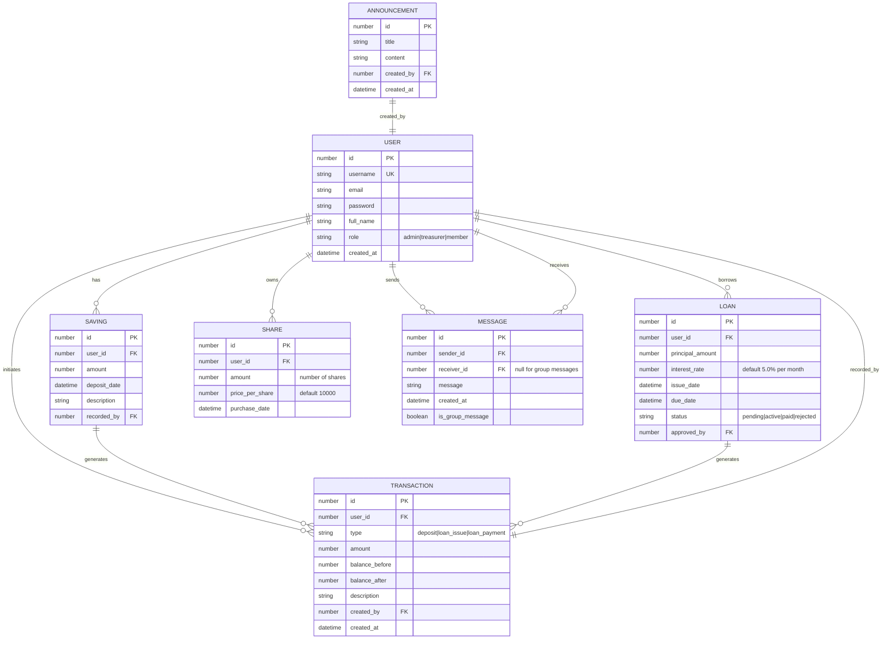

# Data Model & Entity Relationship Diagram

## Storage Layer

All data is stored in the browser's localStorage under keys prefixed with `sacco_`. The `DB` utility object provides `get()`, `set()`, and `genId()` methods.

```javascript
const DB = {
  get(k)   // reads and parses JSON from localStorage.getItem('sacco_' + k)
  set(k, v) // serializes and writes localStorage.setItem('sacco_' + k, JSON.stringify(v))
  genId(arr) // generates auto-incrementing IDs based on existing array
}
```

## Entity Relationship Diagram (Mermaid)



## Data Dictionary

### `users`
| Field | Type | Description |
|-------|------|-------------|
| id | number | Primary key, auto-increment |
| username | string | Unique login identifier |
| email | string | Email address |
| password | string | Plain text (no hashing — no server) |
| full_name | string | Display name |
| role | string | `admin`, `treasurer`, or `member` |
| created_at | ISO 8601 | Account creation timestamp |

### `savings`
| Field | Type | Description |
|-------|------|-------------|
| id | number | Primary key |
| user_id | number | Foreign key → users.id |
| amount | number | Deposit amount in UGX |
| deposit_date | ISO 8601 | Date of deposit |
| description | string | Optional note |
| recorded_by | number | Foreign key → users.id (who processed it) |

### `loans`
| Field | Type | Description |
|-------|------|-------------|
| id | number | Primary key |
| user_id | number | Foreign key → users.id |
| principal_amount | number | Original loan amount in UGX |
| interest_rate | number | Monthly interest rate (default 5%) |
| issue_date | ISO 8601 | When the loan was approved/issued |
| due_date | ISO 8601 | Repayment deadline |
| status | string | `pending` → `active` → `paid` or `rejected` |
| approved_by | number | Foreign key → users.id (treasurer/admin) |

### `shares`
| Field | Type | Description |
|-------|------|-------------|
| id | number | Primary key |
| user_id | number | Foreign key → users.id |
| amount | number | Number of shares owned |
| price_per_share | number | Price per share in UGX (default 10,000) |
| purchase_date | ISO 8601 | When shares were purchased |

### `transactions`
| Field | Type | Description |
|-------|------|-------------|
| id | number | Primary key |
| user_id | number | Foreign key → users.id |
| type | string | `deposit`, `loan_issue`, `loan_payment` |
| amount | number | Transaction amount |
| balance_before | number | Running balance before (reserved) |
| balance_after | number | Running balance after (reserved) |
| description | string | Transaction note |
| created_by | number | Foreign key → users.id |
| created_at | ISO 8601 | Transaction timestamp |

### `messages`
| Field | Type | Description |
|-------|------|-------------|
| id | number | Primary key |
| sender_id | number | Foreign key → users.id |
| receiver_id | number | Foreign key → users.id (null = group) |
| message | string | Message content (max 500 chars) |
| created_at | ISO 8601 | Send timestamp |
| is_group_message | boolean | 1 = group chat, 0 = private DM |

### `announcements`
| Field | Type | Description |
|-------|------|-------------|
| id | number | Primary key |
| title | string | Announcement headline |
| content | string | Full announcement body |
| created_by | number | Foreign key → users.id |
| created_at | ISO 8601 | Publication timestamp |

### `generalLedger`
| Field | Type | Description |
|-------|------|-------------|
| id | number | Primary key |
| total_balance | number | Aggregate balance |
| updated_at | ISO 8601 | Last update timestamp |

## Relationship Summary

```
User (1) ──────< (N) Saving
User (1) ──────< (N) Loan
User (1) ──────< (N) Share
User (1) ──────< (N) Transaction (as initiator)
User (1) ──────< (N) Transaction (as recorder)
User (1) ──────< (N) Message (as sender)
User (1) ──────< (N) Message (as receiver)
User (1) ──────< (N) Announcement (as creator)
Saving (1) ────< (N) Transaction (one deposit may generate one tx record)
Loan (1) ──────< (N) Transaction (loan issue and payments generate tx records)
```

## Initial Seed Data

Upon first load (no `sacco_initialized` flag), the system generates:
- **21 users**: 1 admin, 1 treasurer, 19 members (18 auto-generated)
- **~57 savings deposits**: 3 per member with random amounts (50k-250k UGX)
- **~6 active loans**: every 3rd member gets a loan (200k-1M UGX at 5%/month)
- **3 announcements**: Welcome message, AGM notice, interest rate notice
- **5 messages**: Welcome group chat messages + 2 admin-treasurer DMs
- **~63 transactions**: auto-generated from savings and loans

All seed data dates to 2025 to simulate a running system.
